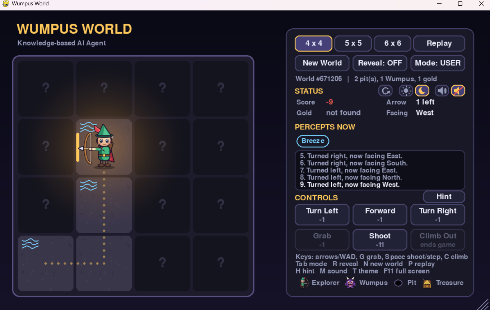

# Wumpus World: a knowledge-based AI agent (Python + Pygame)

An explorer enters a dark cave. Somewhere inside are a **Wumpus** (a monster), deadly **pits** and a pile of **gold**.
The explorer can't see the cave. It only senses breezes, stenches and glitter, and it must reason its way to the gold and back out alive.

You can **play it yourself** or **watch an AI agent play**, and switch between the two at any time.

> **Live demo:** _link will be added here after deployment_



## Features

- **Two modes:** User mode (mouse buttons or keyboard) and AI mode (Step or Auto-Play, with a speed slider).
- **A real knowledge-based AI.** It uses only what it senses (never the hidden map) and shows its reasoning for every action.
- **Grid sizes 4 x 4, 5 x 5 and 6 x 6.** The number of pits grows with the grid. Every world is checked so that a safe route to the gold exists.
- **Hint button** in User mode: the AI tells you what it would do, for free.
- **Replay** the same world, or start a **New World**. A world can also be revealed at any time.
- **Game over card** with the result and final score, plus a refresh button.
- **Dotted trail** showing where the explorer has walked.
- **Animations and sound** (made in code, no audio files), with a mute button.
- **Light and dark themes.**
- **Resizable window:** drag the window edge, drag the corner grip, or press F11 for full screen. The whole interface scales.

## How to run

You need Python 3.10 or newer.

```
python -m venv venv
venv\Scripts\activate          (Windows)   |   source venv/bin/activate   (Mac/Linux)
pip install -r requirements.txt
python main.py
```

## The rules

| Percept | Meaning |
|---|---|
| Breeze | a pit is in a cell next to you |
| Stench | the Wumpus is in a cell next to you |
| Glitter | the gold is in your cell |
| Bump | you walked into a wall |
| Scream | your arrow killed the Wumpus |

| Action | Score |
|---|---|
| Any action (move, turn, grab, climb) | -1 |
| Shooting the arrow | -10 (so -11 in total) |
| Climbing out **with** the gold | +1000 |
| Falling into a pit or meeting the Wumpus | -1000 |

You have **one arrow**. The start cell is always safe. You win by climbing out at the start with the gold.

## Controls

| Key | What it does |
|---|---|
| Arrow keys or W / A / D | move forward, turn left, turn right |
| G | grab the gold |
| Space | shoot the arrow (User mode) or take one AI step (AI mode) |
| C | climb out |
| Tab | switch User / AI mode |
| H | hint (User mode) |
| R | reveal or hide the whole cave |
| N / P | new world / replay the same world |
| 4, 5, 6 | grid size |
| M / T | sound on-off / light-dark theme |
| F11 | full screen |
| - and = | make the window smaller or bigger |
| Esc | quit |

All the keyboard actions are also available as buttons on the screen.

## How the AI thinks

The agent never sees the cave. After every action it receives only the percepts for its current cell.

1. **Remember** what each visited cell felt (breeze? stench?).
2. **Reason by model checking.** List every placement of pits that agrees with everything sensed. A cell is **safe** if no placement puts a pit or the Wumpus there, and it **has a pit** if every placement does. This is propositional logic.
3. **Decide**, in this order:
   1. Glitter here: grab the gold.
   2. Holding the gold: walk home over safe cells (breadth-first search) and climb out.
   3. A safe cell not yet visited: walk to the nearest one.
   4. Stuck, with a stench sensed and the arrow left: go to the best shooting spot and shoot.
   5. Otherwise take the least risky step, but only if the chance of dying is 50% or less. If it is higher, give up and climb out.

When no cell is certain, risk is estimated by weighting each pit layout: a layout with more pits is less likely.

The side panel shows the AI's current thought, and the board marks cells it believes are `safe`, a `pit`, the `wumpus`, or `danger?`.

## Documentation

- [Algorithm write-up](docs/algorithm.md): how the AI reasons and decides, with a worked example
- Flowchart of the AI's decision: [docs/flowchart-decision.png](docs/flowchart-decision.png)
- Flowchart of how one action flows through the program: [docs/flowchart-flow.png](docs/flowchart-flow.png)

## Project structure

```
world.py     the hidden cave: pits, Wumpus, gold, percepts, solvability check
game.py      the rules and the score (used by both the human and the AI)
kb.py        the knowledge base: what the agent knows and can prove
agent.py     the AI: observes, decides, explains
effects.py   animations, sound effects and the speed slider
sprites.py   the explorer, Wumpus, pit and gold, drawn in code
ui.py        all the drawing (it never changes the game)
main.py      the window, buttons, keyboard and the main loop
tests/       automatic tests
```

The human and the AI both act through the same `game.act()` function, so the rules are identical for both and the AI cannot cheat.

## Tests

```
python -m pytest -q
```

43 tests check the world generator, the rules and scoring, the knowledge base's reasoning, and the agent's decisions. One test builds two different caves that look identical at the start and checks that the AI makes the same move in both, which shows it uses only percepts.

## Built with

- Python 3
- [pygame-ce](https://pyga.me) for the window, drawing, input and sound
- pytest for the tests

No images, sound files, web server or database are needed.

## Author

Likhitha Akula: [GitHub](https://github.com/Likhitha-Akula) | [LinkedIn](https://linkedin.com/in/likhitha-akula)