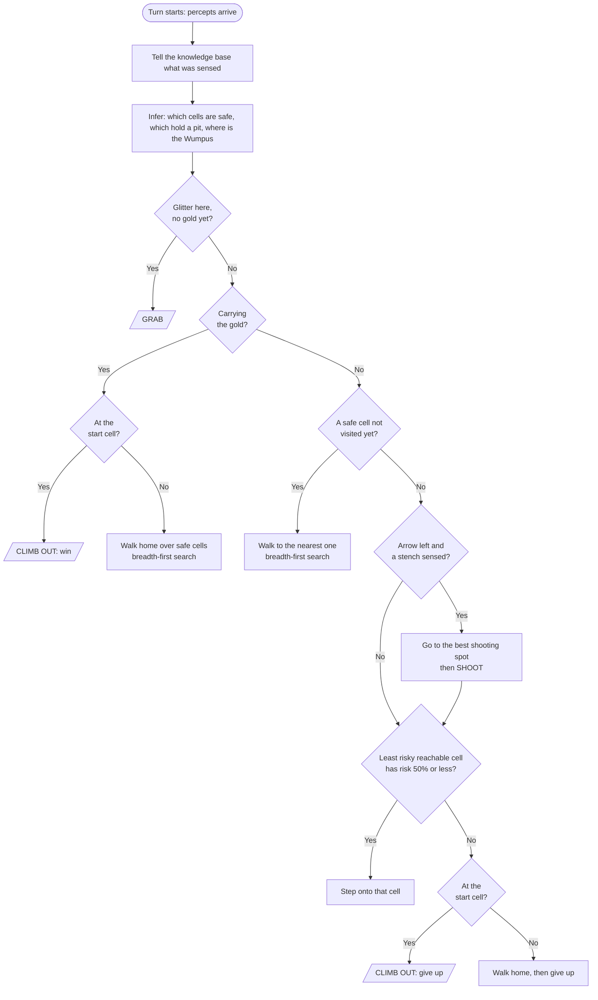
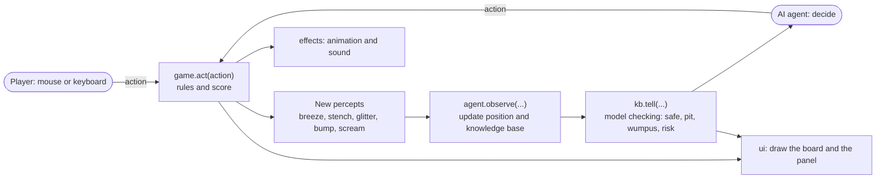

# Algorithm write-up

## 1. The problem

An agent starts in cell (0, 0) of a hidden N x N cave (N = 4, 5 or 6). It does not know where the pits, the Wumpus and the gold are.
After every action it receives five percepts (breeze, stench, glitter, bump, scream), and it must find the gold and climb back out, scoring as high as possible.

This is a **partially observable** problem. The agent must reason about what it cannot see, from what it can.

## 2. The idea in one paragraph

The agent keeps a **knowledge base** (KB) of everything it has sensed. After each move it uses **logical inference by model checking** to work out which cells are certainly safe, which certainly hold a pit, and where the Wumpus can be.
It then picks an action with a fixed priority list, using **breadth-first search (BFS)** to walk along cells it knows are safe.
When nothing is certain, it compares risks and only gambles when the chance of dying is 50% or less.

## 3. Flowchart: the AI's decision each turn

## 4. Flowchart: how one action flows through the program

The player and the AI both send actions into the **same** `game.act()`. The AI only ever receives percepts back, never the hidden cave.

## 5. Step by step

**Every turn:**

1. `observe(action, percepts)`: update the agent's own position and facing (dead reckoning: a turn changes the facing, a forward move without a bump changes the position), then `kb.tell(cell, percepts)`.
2. `kb.tell` records breeze and stench for the current cell and re-runs the inference (section 6).
3. `decide()` goes down the priority list:
   1. **Glitter here and no gold yet:** `GRAB`.
   2. **Carrying the gold:** if at the start, `CLIMB`; otherwise take one step of the BFS path home.
   3. **A safe, unvisited cell exists:** take one step of the BFS path to the nearest one.
   4. **Stuck, arrow left, a stench sensed:** go to the cell and facing from which the arrow crosses the most cells where the Wumpus may be, then `SHOOT`.
   5. **Otherwise:** pick the reachable cell with the lowest risk. If its risk is 50% or less, step onto it. If not, go home and `CLIMB` (give up).
4. After a shot with no scream, every cell along the arrow's line is ruled out as a Wumpus location.

## 6. The inference (model checking)

**Rules of the world, written as logic:**

- No breeze at X: none of X's neighbours has a pit.
- Breeze at X: at least one neighbour of X has a pit.
- No stench at X: the Wumpus is in none of X's neighbours.
- Stench at X: the Wumpus is in one of X's neighbours.

**Method:**

1. The **frontier** is the set of unvisited cells that touch a visited cell. Only these can be constrained by what we sensed.
2. Try every True/False assignment of "pit here?" to the frontier cells, using backtracking, and drop an assignment as soon as it breaks one of the rules above. What remains is the list of **models**, the layouts that fit what we know.
3. A frontier cell **has a pit** if it has a pit in *all* models. It is **pit-free** if it has a pit in *none*. Otherwise it is **uncertain**.
4. Wumpus candidates are the unvisited cells that agree with every stench observation (and have not been ruled out by a missed arrow). If only one is left, the Wumpus is found.
5. A cell is **safe** only if it cannot hold a pit *and* cannot hold the Wumpus.

**Worked example.** The start (0,0) has a breeze, so a pit is at (1,0) or (0,1). The agent steps to (1,0) only if it knows it is safe. Here it isn't certain, so it first tries other options. If it later learns that (1,0) is safe and calm, then in every model (0,1) holds the pit, so the agent marks (0,1) as a pit and never goes there. This exact case is a test in `tests/test_kb.py`.

**Risk estimate.** When nothing is certain, each model is weighted by (p / (1 - p)) for every pit it contains, with p = 0.15. A layout with more pits is less likely. The risk of a cell is the weight of the models where it has a pit divided by the total weight, plus a share for the chance that the Wumpus is there.

## 7. Breadth-first search

BFS starts at the agent's cell and explores outward one step at a time, moving only through cells that are visited or proven safe. The first time it reaches a goal cell, it has found a shortest path. The agent then takes the first step of that path, and the whole search is repeated next turn with updated knowledge.

## 8. Why the AI cannot cheat

`Agent` is created with the first percepts only. It never gets the `World` object. It tracks its own position by counting its moves. A test builds two different caves that look identical at the start and checks that the agent makes the same first move in both.

## 9. Complexity

- **BFS:** O(N²) per call, since there are N² cells.
- **Model checking:** in the worst case the number of models grows exponentially with the frontier size (2^f). Backtracking cuts most of it, since an assignment is dropped as soon as it breaks a rule, and for grids up to 6 x 6 the frontier stays small, so it is fast enough for a smooth game.

## 10. Known limits

- A breeze next to the start with no safe alternative leaves a 50/50 guess, and the agent plays it safe by giving up (score -1) rather than risking -1000. This is a choice, not a bug: `MAX_RISK` in `agent.py` controls it.
- The risk numbers are estimates, not exact probabilities.
- Not every random world can be won by logic alone, which is why some games end with the agent leaving without the gold.